<p align="center">
  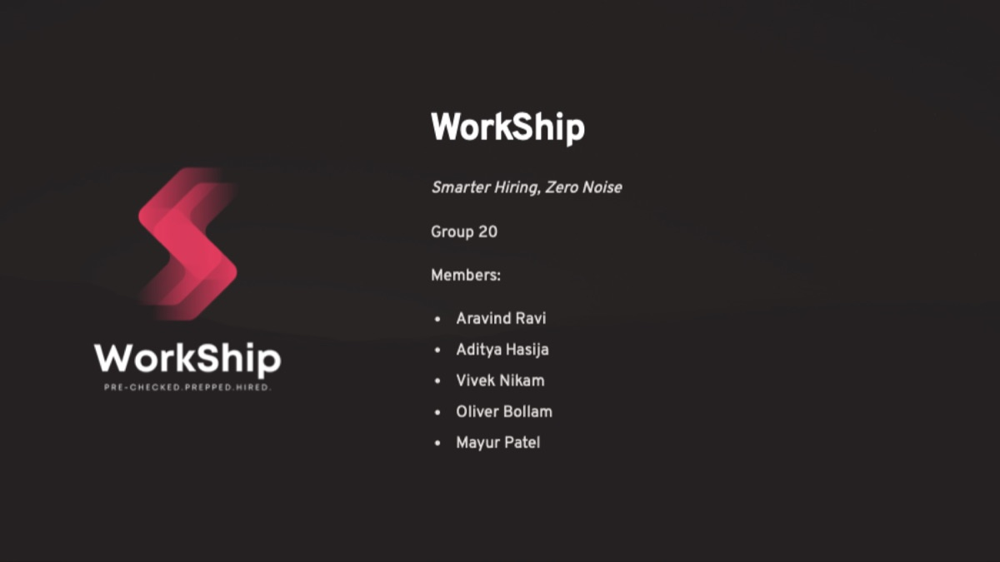
</p>

<h1 align="center">WorkShip</h1>

<p align="center">
  <b>Smarter hiring, zero noise.</b><br>
  A job portal concept where every candidate is pre-verified, every listing is real, and every application gets an answer.
</p>

<p align="center">
  <a href="https://www.figma.com/proto/CRmPtlj1NyeqXDfQQQRSwM/Workship---Wireframes?node-id=0-1&t=ZczFhPyOQYl5Miyo-1"><b>▶ Figma prototype</b></a> ·
  <a href="https://www.figma.com/design/CRmPtlj1NyeqXDfQQQRSwM/Workship---Wireframes">Figma file</a> ·
  <a href="docs/pdf/WorkShip-Final-Presentation.pdf">Final presentation (PDF)</a> ·
  <a href="docs/pdf/WorkShip-Research-Report.pdf">Research report (PDF)</a>
</p>

---

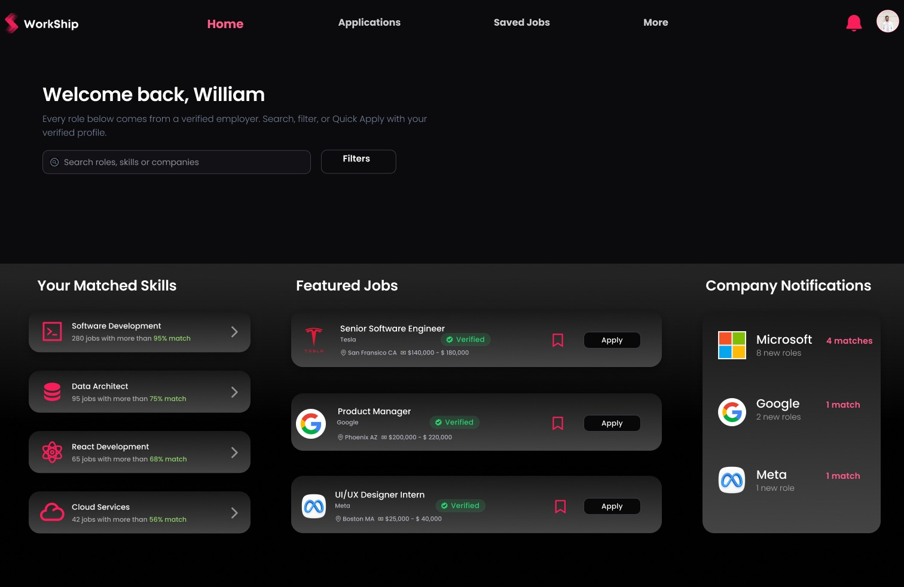

## TL;DR

| | |
|---|---|
| **What** | Product and UX design for a two-sided hiring platform (job hunters + recruiters) built around verification and transparency |
| **Type** | Product design case study, wireframes and clickable prototype (no production code) |
| **Team** | Group 20, five people (see [Team](#team)) |
| **My role** | Product lead and designer: problem framing, product objectives, use cases, UX research, wireframes and UI in Figma, final presentation |
| **Tools** | Figma, Moqups, Google Slides |

## The problem

Hiring is broken on both sides of the table.

- **Recruiters** are flooded with fake, inflated, duplicate and irrelevant applications, and verifying credentials is slow and expensive.
- **Job seekers** fill out the same form on every portal, compete with people who fake experience, run into scam listings, and rarely hear back.

The platforms in the middle (LinkedIn, Indeed, Workday) verify employers at best, validate candidates only by email, and leave both sides in the dark once an application is sent.

## The solution

WorkShip makes **trust the default** instead of an add-on:

1. **Verify once, apply everywhere.** Candidates verify skills, education and experience once, and that verified profile powers one-click Quick Apply.
2. **Verified listings only.** Both employers *and* individual job posts are verified, with AI-driven fraud detection and a company Trust Score.
3. **No black holes.** Real-time application status at every stage, plus **Career Compass** (a journey dashboard) and **Wingman AI** (drafts follow-ups to hiring managers).
4. **Recruiters get a clean funnel.** A pre-verified talent pool, skill-based filtering and an end-to-end flow from posting to hire, with shared accountability for responding to candidates.

## Product objectives

| Objective | What it means |
|---|---|
| Verified hiring ecosystem | Authenticity of both candidates and job listings |
| Transparent job search | Status updates and direct conversations |
| Streamlined applications | No redundant forms, so a better applicant experience |
| Eliminate fake listings and profiles | Stop fraudulent posts and fake credentials |
| Fast-track hiring | Structured tools so recruiters verify and hire faster |

## Who it's for

| Job hunters | Recruiters |
|---|---|
| Students looking for internships, recent grads, experienced professionals, career changers, freelancers and contract workers | Talent acquisition agencies and organizations hiring directly |

**Personas:** [Alex Sharma](docs/research.md#personas) (23, recent CS grad) and [Priya Mehta](docs/research.md#personas) (35, HR manager at a fast-growing startup).

## Key flows

| Flow | Screens in Figma |
|---|---|
| Landing, sign-up and login (job hunter / recruiter toggle) | `LANDING AND LOGIN SCREENS` |
| Profile creation and guided onboarding | `PROFILE CREATION AND ONBOARDING` |
| Job hunter home (matched skills, featured jobs, company updates) | `JOB HUNTER HOME PAGE VARIATIONS` |
| Job hunter profile and verification status | `JH PROFILE SCREEN VARIATIONS` |
| Candidate re-verification | `CANDIDATE RE-VERIFICATION FLOW` |
| More: Career Compass, Wingman AI, analytics | `MORE SECTION (CAREER COMPASS …)`, `Analytics` |
| Recruiter: post a job → review verified applicants → hire | `RECRUITER END-TO-END FLOW` |

See [docs/screens.md](docs/screens.md) for the screen-by-screen walkthrough.

### Sign-up and onboarding

<table>
  <tr>
    <td colspan="2">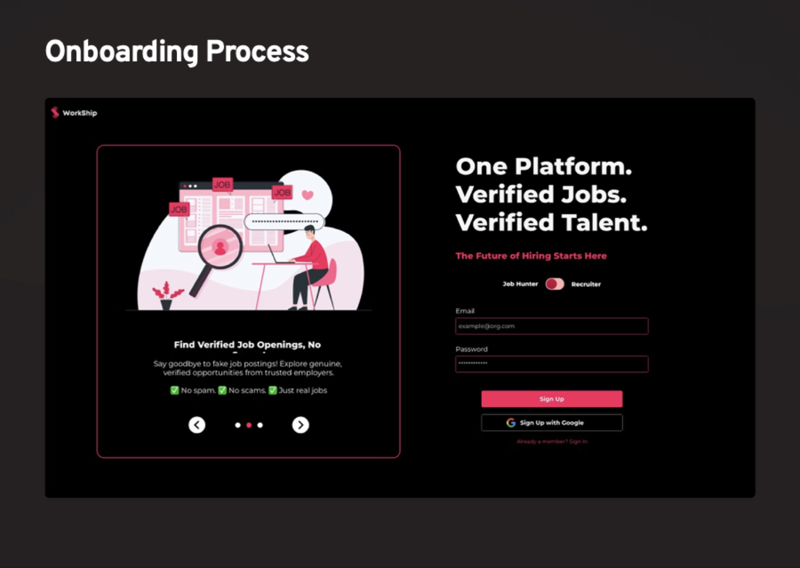</td>
  </tr>
  <tr>
    <td>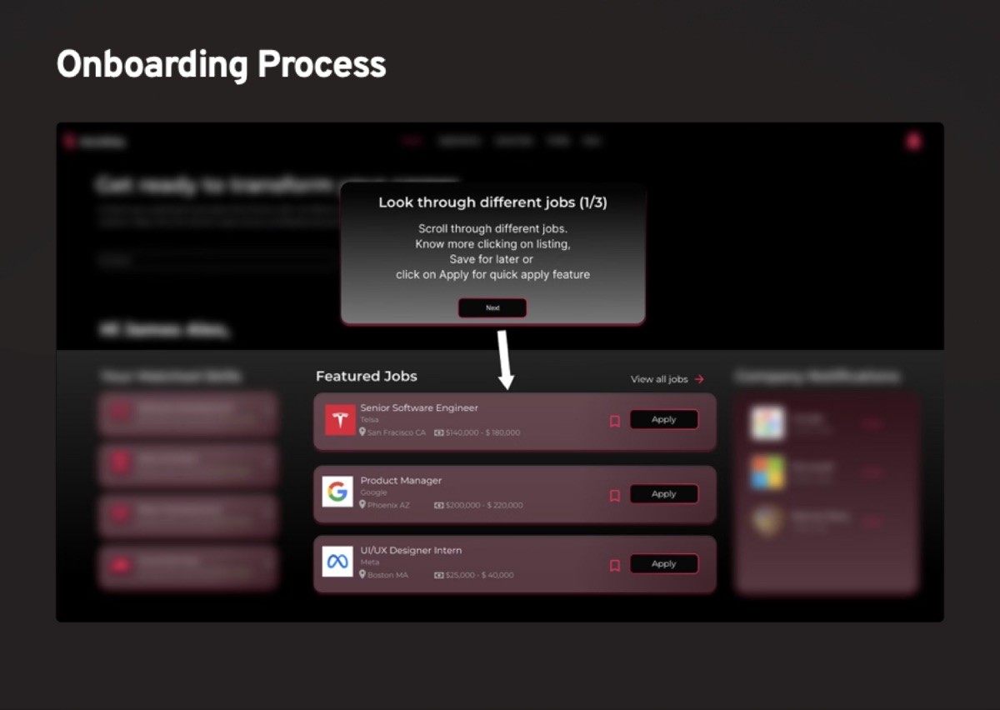</td>
    <td>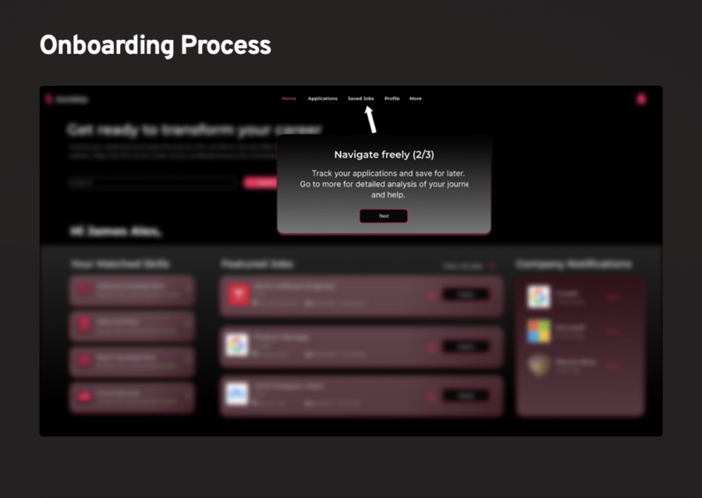</td>
  </tr>
</table>

## Research

We used three methods, each chosen for a specific gap:

- **Competitive analysis** (LinkedIn, Indeed, Workday) to find where trust breaks down. → [docs/competitive-analysis.md](docs/competitive-analysis.md)
- **Empathy maps** for job seekers and employers, to surface the frustrations surveys miss. → [docs/research.md](docs/research.md#empathy-maps)
- **Storyboards** for Alex (job seeker) and Rachel (recruiter), to align the team on journeys before designing screens. → [docs/research.md](docs/research.md#storyboards)

Use cases and alternate flows are written up in [docs/use-cases.md](docs/use-cases.md).

## Design v2: from wireframes to a polished system

I audited all ~100 v1 frames ([docs/design-review.md](docs/design-review.md)) and rebuilt them as **v2** in the same Figma file. The v1 originals are kept untouched for comparison. Highlights:

- **Design tokens and components:** 35 variables, 9 text styles, and new `Badge/Status`, `Badge/Verified`, `Stage Tracker`, `Segmented Control` and `Stepper` components
- **Trust made visible:** Verified badges on jobs, and a stage tracker on every application
- **Semantic color and accessibility:** pink is reserved for actions; statuses get success/warning/danger colors; the brand fill was adjusted so button text passes WCAG AA
- **Clearer flows:** labeled steppers, honest charts (bar instead of line for categories), and no destructive actions styled as primary

| Before (v1) | After (v2) |
|---|---|
| 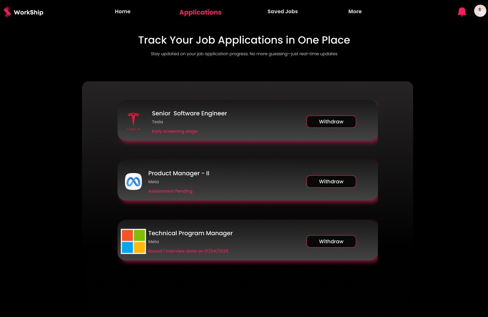 | 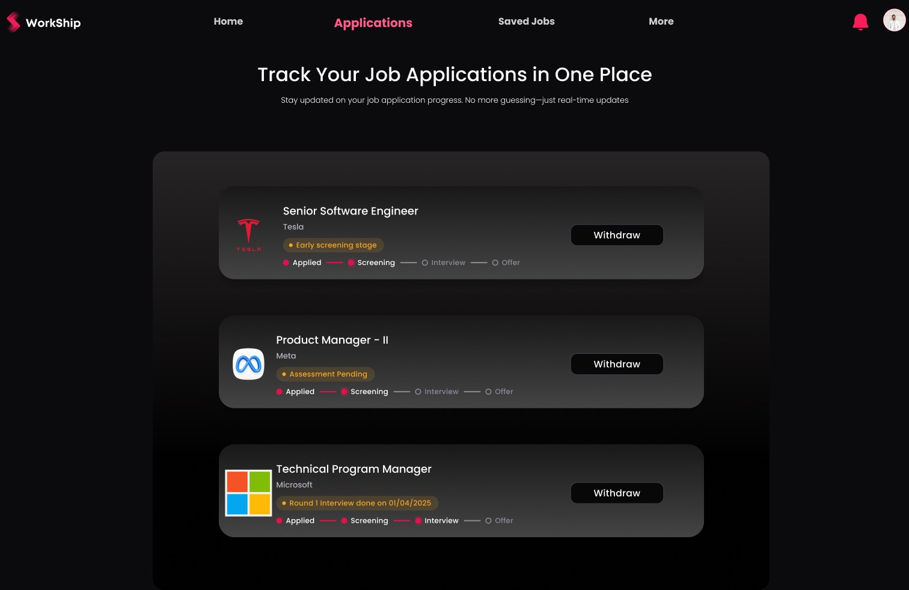 |

<table>
  <tr>
    <td>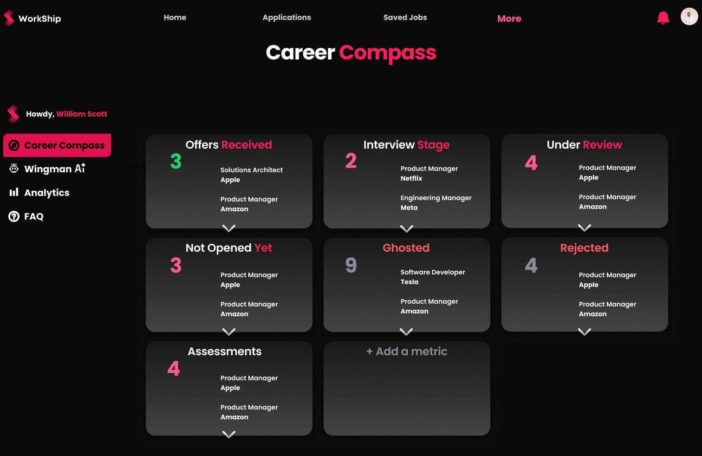</td>
    <td>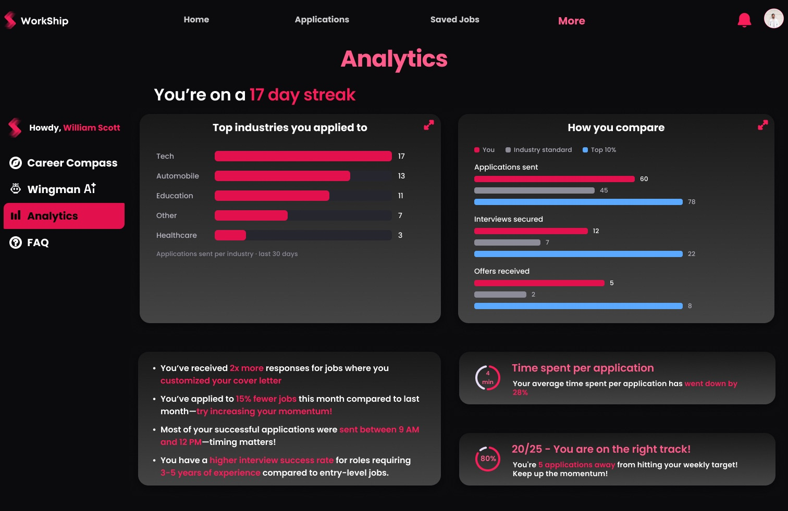</td>
  </tr>
  <tr>
    <td>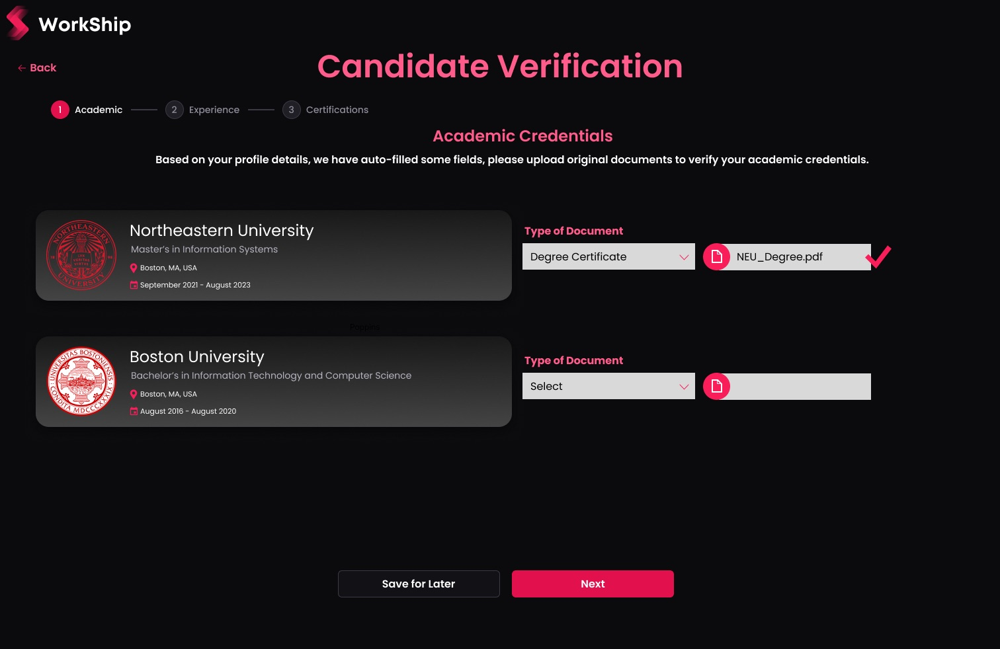</td>
    <td>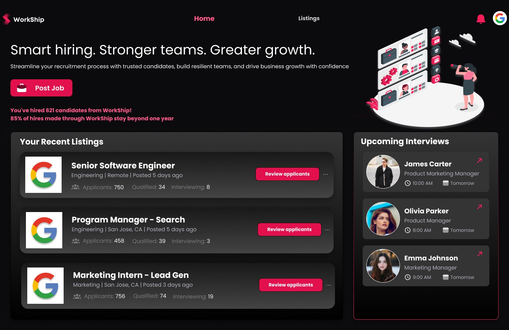</td>
  </tr>
</table>

Every change is logged in [CHANGELOG.md](CHANGELOG.md).

## Design system

Dark UI with a pink brand color, Poppins type and Material icons. v2 adds variables, text styles and components.
→ [docs/design-system.md](docs/design-system.md)

## Repository map

```
.
├── README.md                    ← you are here
├── CHANGELOG.md                 ← design + docs changes over time
├── assets/                      ← images used in these docs (v2/ = polished screens + before/after)
└── docs/
    ├── design-review.md         ← UX audit of v1 → prioritized fixes → what shipped in v2
    ├── research.md              ← problem, audiences, personas, pain points, empathy maps, storyboards
    ├── competitive-analysis.md  ← feature + UX comparison vs LinkedIn, Indeed, Workday
    ├── use-cases.md             ← middleweight + heavyweight use cases
    ├── screens.md               ← screen-by-screen walkthrough of the Figma file
    ├── design-system.md         ← color, type, components
    └── pdf/                     ← original research report + final presentation
```

## What's next

- [ ] Usability test the prototype with job seekers and recruiters
- [x] Polish the wireframes into a high-fidelity v2 (see [CHANGELOG.md](CHANGELOG.md))
- [ ] Layout pass: convert v1's absolutely-positioned screens to auto-layout and raise 10–11px text to 12px+
- [ ] Define success metrics (time-to-hire, application response rate, verified-profile completion)
- [ ] Go-to-market: channels, pricing, partnerships for credential verification

## Team

Group 20: **Aravind Ravi**, **Aditya Hasija**, **Vivek Nikam**, **Oliver Bollam**, **Mayur Patel**.

Earlier high-fidelity wireframes from the first iteration live in [Moqups](https://app.moqups.com/N9EBV49YeMfJaXQQgoCA57YNQfj8E7s3/view/page/a4e966ab7).

---

<sub>Academic project. Company names and logos in the mockups are placeholders for illustration and imply no affiliation.</sub>
