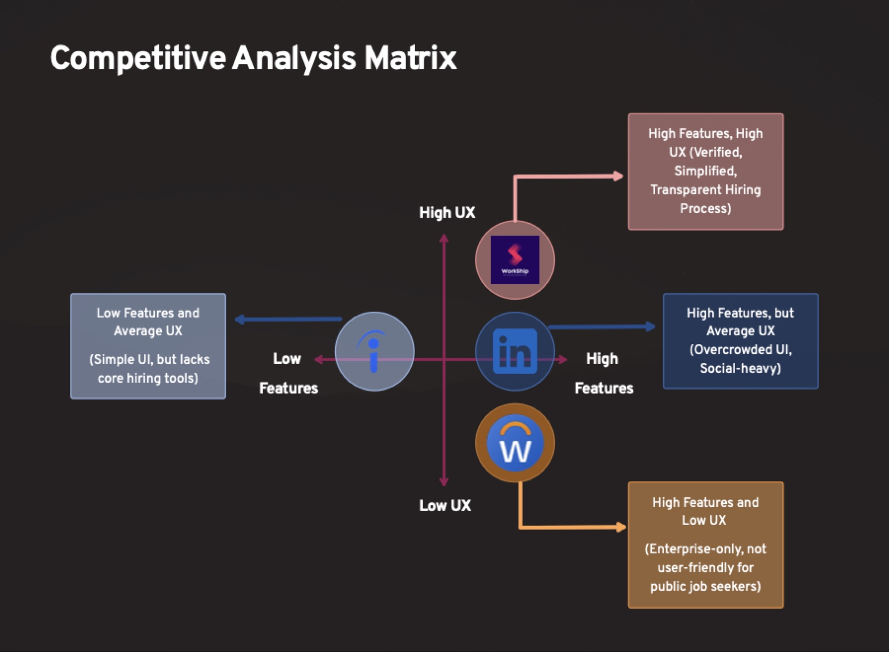

# Competitive analysis

[← Back to README](../README.md)

WorkShip competes on **trust and transparency**: it verifies employers and job listings, verifies candidates holistically, detects fraud with AI, and tracks applications in real time. Those are the gaps we found in LinkedIn, Indeed and Workday.

## Features

| Feature | LinkedIn | Indeed | Workday | **WorkShip** |
|---|---|---|---|---|
| Employer and job listing verification | Employer only | Employer only | Employer only | ✅ **Both employer and listing** |
| End-to-end hiring | ❌ Relies on third-party integrations | Few basic assessments | Initial assessments | ✅ **In-app, end to end** |
| Holistic candidate verification | Email validation only | Email validation only | Email validation only | ✅ **Skills, education, experience** |
| Fake job postings | Frequent complaints | Frequent complaints | Few complaints | ✅ **AI-driven fraud detection** |
| Trust score | No metrics | No metrics | No metrics | ✅ **Defined company-trust metrics** |
| Job search experience | Advanced filtering, poor search | Advanced filtering, poor search | Internal postings, limited search | ✅ **Relevant results only** |
| Application tracking | Initial updates | Initial updates | ✅ Enterprise-level tracking | **Real-time updates at each stage** |
| Recruiter accountability | ❌ Limited | Limited | HR accountable | ✅ **Shared accountability** |

## Usability and UX

| Dimension | LinkedIn | Indeed | Workday | **WorkShip** |
|---|---|---|---|---|
| Navigation and UI simplicity | Overcrowded with social features | Simple, but information overload | Unintuitive, complex | Minimal and intuitive, with easy matching |
| Mobile | Good, but cluttered by the feed | Functional but information-heavy | Desktop-first | Mobile-optimized, streamlined |
| Application flow | Easy Apply | Quick apply, few employer insights | Redundant and complex | One-click apply for verified candidates |
| Information access | Too much, cluttered | Listings-focused, little company info | Needs training | Structured, with verified employer and salary details |

## Positioning

On a matrix of **features vs UX**, the three competitors split:

- **LinkedIn** has many features but only average UX, because the UI is overcrowded and social-heavy.
- **Workday** has many features but low UX, because it is enterprise-only and not built for public job seekers.
- **Indeed** has fewer features and average UX: a simple UI, but no core hiring tools.

WorkShip aims for the empty quadrant: **many features *and* high UX**, built on verification.
