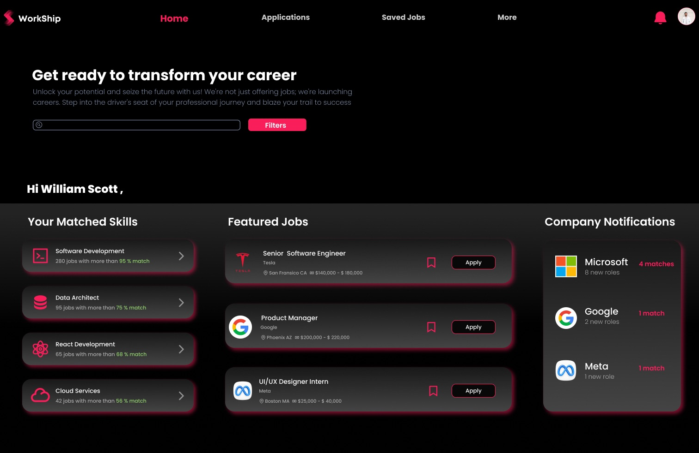
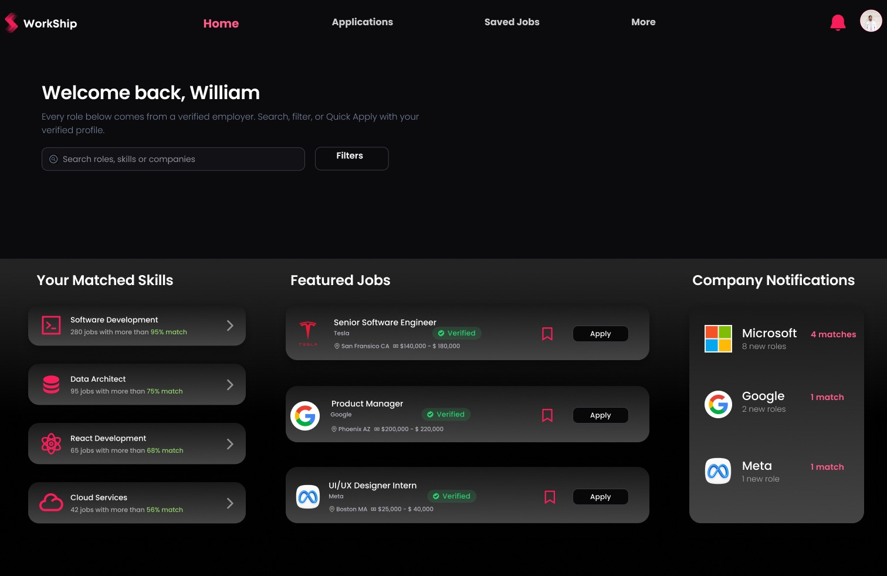
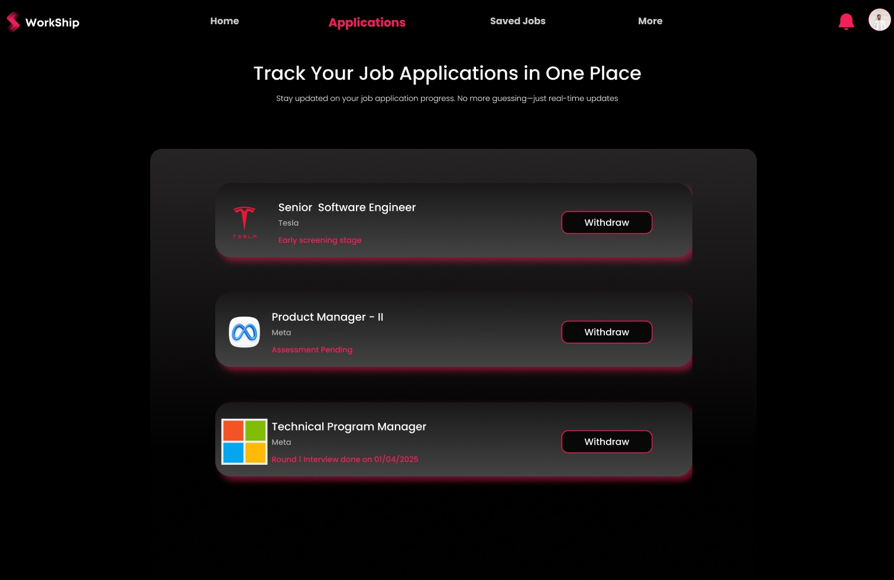
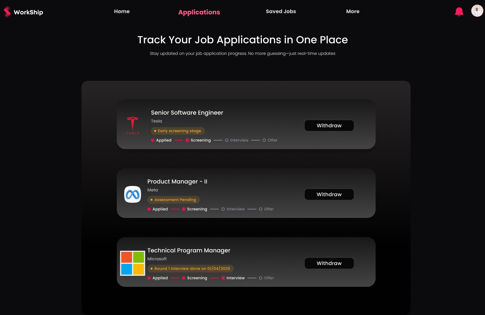

# Design review: wireframes v1 → v2

[← Back to README](../README.md)

An audit of the v1 Figma wireframes (~100 frames at 1512 × 982 across 7 flows), with improvements ranked by user impact. The product concept, flows and features stay the same. The changes target clarity, hierarchy, consistency and accessibility.

**Legend:** 🔴 P0, blocks comprehension or trust · 🟠 P1, slows users down or reads as unpolished · 🟡 P2, refinement

---

## 1. System-level findings

These affect every screen, so fixing them once has the highest leverage.

| # | Pri | Finding | Fix in v2 |
|---|---|---|---|
| S1 | 🔴 | **One pink does every job.** Brand `#F91F59` is used for primary buttons, active nav, links, statuses ("Assessment Pending"), destructive actions ("Close", "Sign Out") and input borders. Users can't tell an error from a link from a status. | Semantic color roles: brand/primary, success, warning, danger and info, each with its own token. Pink is reserved for primary actions and the active state. |
| S2 | 🔴 | **Inputs look like they're in an error state.** Every text field has a red/pink border before the user types anything. | Neutral border by default, a brand-colored focus ring, and red only for validation errors. |
| S3 | 🔴 | **The core value prop is invisible.** "Verified" is the whole product, but job cards, company cards and candidate cards show no verification badge. | A reusable `Verified` badge on job, company and candidate cards, plus the profile header. |
| S4 | 🟠 | **No design tokens.** 0 variables, 0 text styles, 0 color styles, and 14+ ad-hoc type sizes (including 12.95px and 11.1px). | Color variables and a 7-step type scale (Poppins for display, Inter for UI text), applied to v2 frames. |
| S5 | 🟠 | **Low-contrast small text.** 10–12px gray or pink text on near-black (metadata, helper text, "Already a member? Sign in") falls below WCAG AA 4.5:1. | Body text at least 14px, metadata at least 12px in `text/secondary` (#B3B3B3 on #0A0A0A ≈ 9:1), and links underlined. |
| S6 | 🟠 | **A heavy pink glow on every card** flattens the hierarchy, because when everything glows nothing stands out. | Flat surfaces with 1px borders and elevation steps, with glow reserved for the single primary CTA. |
| S7 | 🟠 | **Navigation drifts.** The job hunter nav shows "More" in some frames and "Career Compass" in others, Profile appears only as an unlabeled avatar, and the active-tab style changes size between frames. | One nav component with fixed items and a consistent active indicator. |
| S8 | 🟡 | **Content and data mismatches undercut the story,** e.g. "Technical Program Manager — Meta" next to a Microsoft logo, a Tesla profile describing "TechVision Inc.", and Wingman signing off as "Aravind Ravi" for William Scott. | Data made consistent per persona (William Scott, job hunter; recruiter at the hiring company). |
| S9 | 🟡 | **Typos:** "Seach Results", "Succesfully", "Jon Listing Success" (layer), "San Fracisco". | Fixed. |
| S10 | 🟡 | **Real brands and people.** Real company logos, a photo of a real CEO and real office photography appear in a public portfolio piece. | Logos kept (decision). Photos of people and offices replaced with brand banners. |

## 2. Screen-by-screen findings

### Landing and auth

| Pri | Screen | Finding | Fix |
|---|---|---|---|
| 🟠 | Landing | The role cards don't look clickable: no CTA, gray illustrations, and the hover state only exists as separate frames. | Role cards with a clear title, a one-line benefit and an explicit CTA ("I'm hiring →" / "I'm looking →"). |
| 🔴 | Sign-up | The **Job Hunter ⇄ Recruiter switch is ambiguous**: you can't tell which side is on. | A segmented control with the selected state filled. |
| 🟠 | Sign-up | No password guidance or show/hide, and the email field is pre-filled with a value that looks real. | Placeholder text instead of a value, a show/hide icon, and a password hint. |
| 🟡 | Sign-up | The "Already a member? Sign in" link is 10px and pink-on-black. | 14px, underlined, placed under the primary CTA. |

### Profile creation and onboarding

| Pri | Screen | Finding | Fix |
|---|---|---|---|
| 🔴 | Profile creation | **No progress indicator** across 8 steps, and "Complete Profile" is grayed out with no reason given. | A stepper (Basics → Education → Experience → Verify), plus a disabled-state hint listing what's missing. |
| 🟠 | Profile creation | Helper text is crammed into the label in parentheses, and "Upload document for validation" floats outside the field it belongs to. | Helper text below the field, and the upload control placed inline with the education entry. |
| 🟡 | Coach marks | The tooltip copy is truncated ("…your journe"). | Copy rewritten to fit. |

### Job hunter home, search, applications, saved jobs

| Pri | Screen | Finding | Fix |
|---|---|---|---|
| 🔴 | Home | **Generic marketing copy takes the first fold** ("Get ready to transform your career… blaze your trail") while the user's actual matches sit below it. | A compact header: "Hi William 👋", with search front and center and the hero copy removed. |
| 🟠 | Home | The search field has no placeholder, the Filters button is styled like a primary action, and "Hi William Scott ," has stray punctuation. | Placeholder "Search roles, skills or companies", Filters as a secondary button, greeting fixed. |
| 🟠 | Home | The match % is tiny green-on-gray text. | A match pill on each skill row. |
| 🔴 | Applications | **Status is a line of red text and the only action is "Withdraw".** The transparency promise has no visual form. | A status pill plus a stage tracker (Applied → Screening → Interview → Offer), "Updated 2d ago", and Withdraw moved to a secondary action. |
| 🟠 | Saved jobs | Saved cards show *application* statuses (copied from Applications), with no Apply action. | Saved cards show job info (location, salary, verified) with Quick Apply. |
| 🟠 | Search results | Results show application statuses instead of job info, there's no result count, sort or filters, and the heading says "Seach". | Result count, sort, filter chips, and proper job cards. |
| 🟡 | Job detail | Strong screen (match score, "Improve your match"). The responsibilities list is dense and the match donut has no label. | Responsibilities capped at 6 with "Show more", and the donut labeled "85% match". |
| 🟠 | Company profile | The Trust Score radar has no axis labels, and a real CEO photo is used. | Labeled trust breakdown bars (Verified business, Longevity, Offer-to-hire ratio). |

### Profile and re-verification

| Pri | Screen | Finding | Fix |
|---|---|---|---|
| 🟠 | JH profile | **"Sign Out" is the most prominent action on the profile** (pink, top-right). | Sign Out moved into the avatar menu, with "Edit profile" as the header action. |
| 🟠 | JH profile | "Unverified" and "Reverification required" compete without a clear next step. | One verification banner with a single CTA ("Re-verify 1 credential"). |
| 🟡 | Verification | Stepper numbers 1/2/3 have no labels and are low contrast. | A labeled stepper: Academic → Experience → Identity. |

### More: Career Compass, Wingman AI, Analytics

| Pri | Screen | Finding | Fix |
|---|---|---|---|
| 🟠 | Career Compass | Every tile has the same weight and the same two-tone heading, and "Custom Metric" placeholders ship as-is. | Tiles ordered by funnel stage with status colors (Offer = success, Ghosted/Rejected = muted), and the placeholder tiles replaced by one "+ Add metric" tile. |
| 🟠 | Wingman AI | The **"LLM Stats" panel** (model usage %) is irrelevant to a job seeker, and the prompt box is pre-filled with a 70-word prompt. | Panel replaced with suggested prompts ("Follow up on Apple offer", "Prep for Meta interview"). |
| 🟠 | Wingman AI | The email modal overlaps half-rendered content behind it. | A proper modal with a scrim, plus editable To and Subject fields. |
| 🔴 | Analytics | A **line chart is used for categorical data** (industries), and neither axis is labeled. The benchmark bars stack values that shouldn't sum. | A horizontal bar chart for industries, and grouped bars (You vs Industry vs Top 10%) with labeled axes. |

### Recruiter

| Pri | Screen | Finding | Fix |
|---|---|---|---|
| 🔴 | Recruiter home / listings | **"Close" (a destructive action) is the primary pink button** on every listing. | "Review applicants" becomes primary, with Close in an overflow menu. |
| 🟠 | Job posting | Every field is red-bordered (it reads as an error), and the illustration takes half the screen. | Neutral fields, a two-column form at full width, and the illustration removed. |
| 🟡 | Job posted modal | "Succesfully" typo, and no next step offered. | "Job posted" with CTAs "View listing" / "Post another". |
| 🟡 | Company profile | 9px "About" text and a Sign Out link in the content area. | 14px body text, and Sign Out moved into the avatar menu. |

## 3. What shipped in v2

All 118 nodes on the v1 board were duplicated 26,000px to the right and named `v2 / <original name>`. **v1 is untouched.** A *Read me & changelog* frame and the new components sit above the v2 board. The per-change log is in [CHANGELOG.md](../CHANGELOG.md).

| Before (v1) | After (v2) |
|---|---|
|  |  |
|  |  |

### Status by finding

| Finding | Status |
|---|---|
| S1 Semantic color · S2 Inputs · S4 Tokens · S6 Glow · S7 Nav labels · S8 Data · S9 Typos | ✅ Done across all v2 frames |
| S3 Verified badge | ✅ Featured jobs, saved jobs, search results |
| S5 Contrast | ✅ Brand fill deepened to `#E2114D` (white text ≈ 4.75:1); pink-on-dark text gets its own token `#FF5C8A`; gray text raised to `#B4B4BE`. ⚠️ Text that was 10–11px in v1 was **not** enlarged (risk of overlaps in absolutely-positioned frames); flagged for a layout pass |
| S10 Brands | Decision: **real logos kept**. Photos of real people and offices on company and recruiter profiles were replaced with brand banners |
| Landing, sign-up, profile creation, home, applications, saved, search, verification, profile, Career Compass, Wingman, analytics, recruiter | ✅ As described in section 2 |

### Deferred (not done in v2)

- Password show/hide and a password hint on sign-up
- "Show more" on the job-detail responsibilities list
- Axis labels on the company Trust Score radar
- Wingman's pre-filled long prompt, kept because it shows the feature in action
- Job-posting form left at its v1 two-column + illustration layout (only colors, inputs and copy fixed)
- Converting absolutely-positioned v1 screens to full auto-layout. New pieces are auto-layout components, but most original screen structure is still absolute
