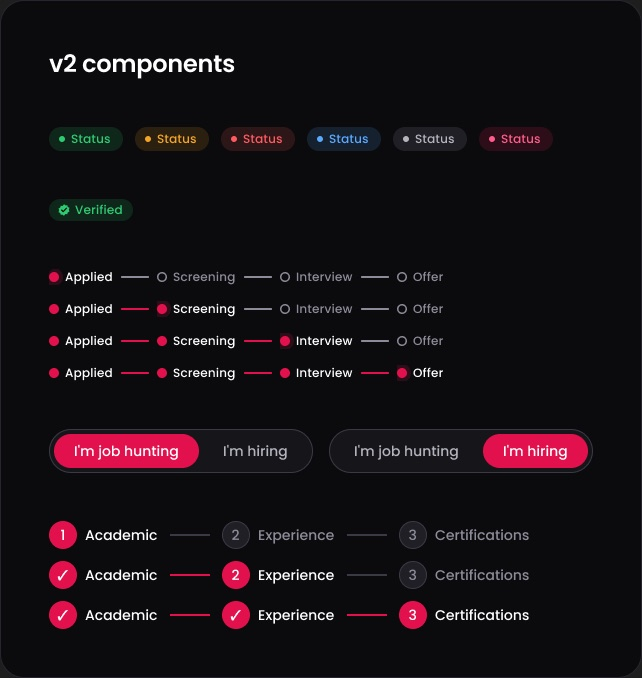
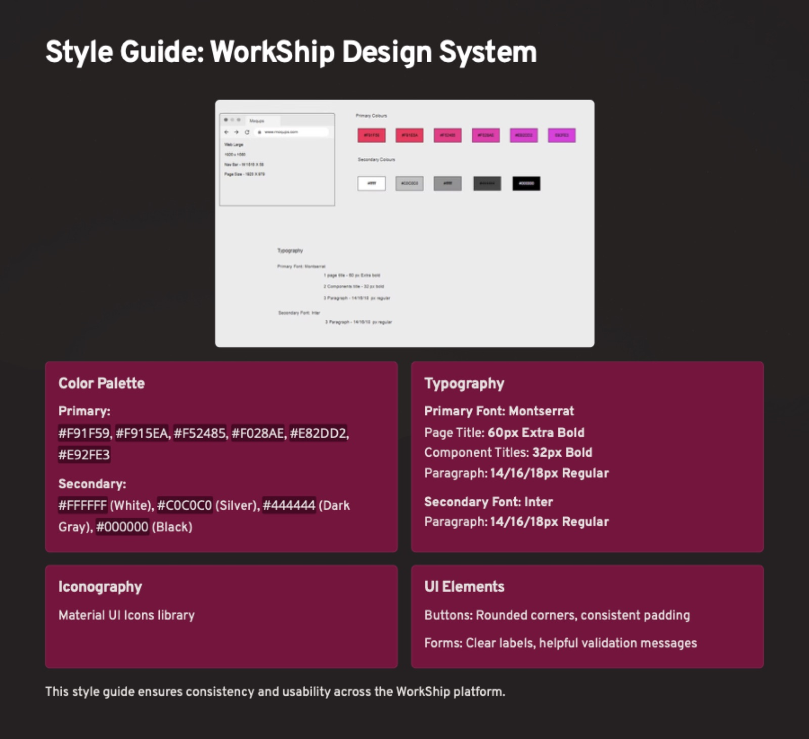

# Design system

[← Back to README](../README.md)

## v2 (Figma variables, styles and components)

v2 turns the style guide below into real Figma primitives. They're in the `WorkShip v2 / Tokens` collection and bound across every `v2 /` frame.

| Token | Value | Use |
|---|---|---|
| `color/bg/canvas` | `#0B0B0D` | Page background |
| `color/bg/surface` · `surface-raised` · `input` | `#16161A` · `#1F1F25` · `#121215` | Cards, chips, fields |
| `color/border/subtle` · `default` | `#26262D` · `#3A3A44` | Card and input borders (pink only on focus) |
| `color/text/primary` · `secondary` · `tertiary` | `#FFFFFF` · `#B4B4BE` · `#8C8C98` | Text hierarchy |
| `color/brand/primary` | `#E2114D` | Primary buttons and active states. White text passes AA (≈4.75:1) |
| `color/brand/text` | `#FF5C8A` | Pink text on dark surfaces |
| `color/status/success` · `warning` · `danger` · `info` | `#2ECC71` · `#F5A524` · `#FF5A5F` · `#5AA9FF` | Statuses (+ `-subtle` 14% fills) |
| `space/4…48` · `radius/sm·md·lg·pill` | 4–48 · 6/10/16/999 | Spacing and corners |

**Type scale (Poppins):** Display 44 Bold · H1 32 · H2 24 · H3 18 SemiBold · Body 16 · Body Small 14 · Label 14 Medium · Caption 12 Medium · Button 14 SemiBold

**Components:** `Badge/Status` (success, warning, danger, info, neutral, brand) · `Badge/Verified` · `Stage Tracker` (Applied → Screening → Interview → Offer) · `Segmented Control/Role` · `Stepper/Verification`

## v1 style guide

## Color

**Primary: brand gradient (pink → magenta)**

| Swatch | Hex |
|---|---|
|  | `#F91F59` |
|  | `#F915EA` |
|  | `#F52485` |
|  | `#F028AE` |
|  | `#E82DD2` |
|  | `#E92FE3` |

**Secondary: neutrals**

| Swatch | Hex | Name |
|---|---|---|
|  | `#FFFFFF` | White |
|  | `#C0C0C0` | Silver |
|  | `#444444` | Dark gray |
|  | `#000000` | Black |

## Typography

| Role | Font | Size / weight |
|---|---|---|
| Page title | Montserrat | 60px Extra Bold |
| Component title | Montserrat | 32px Bold |
| Paragraph | Montserrat or Inter | 14 / 16 / 18px Regular |

## Iconography

[Material UI icons](https://mui.com/material-ui/material-icons/).

## Components

- **Buttons:** rounded corners, consistent padding
- **Forms:** clear labels, helpful validation messages
- **Cards:** job cards (logo, title, company, location, salary, save, Apply), skill-match cards (icon, skill, job count, match %), company notification cards

## Layout

- Desktop canvas: 1920 × 1080 (*Web Large*), with a 1515 × 58 nav bar and a 1920 × 979 page area
- Figma frames are also built at MacBook Pro 14″ size
