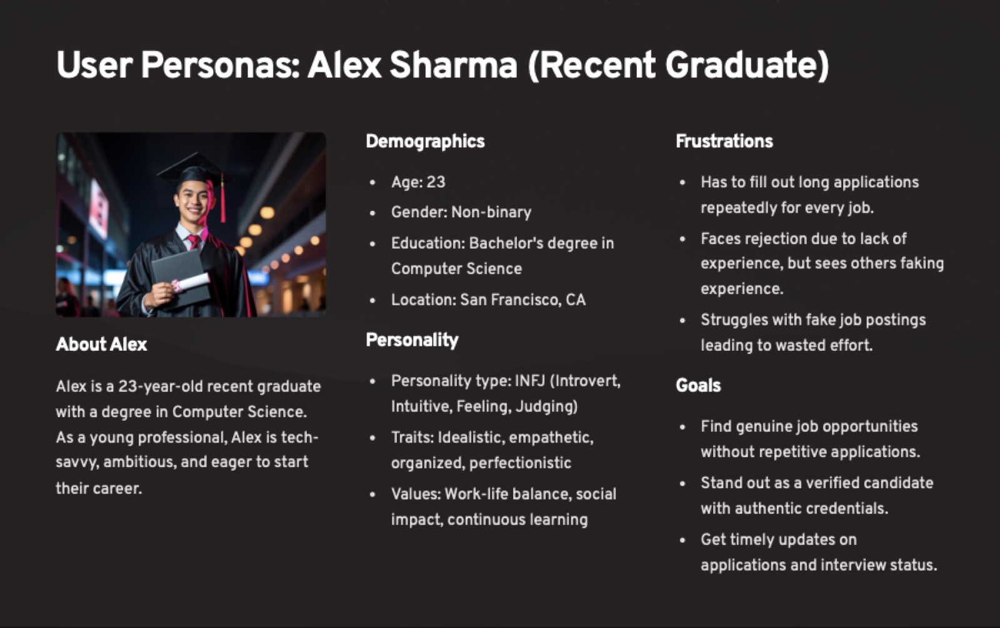
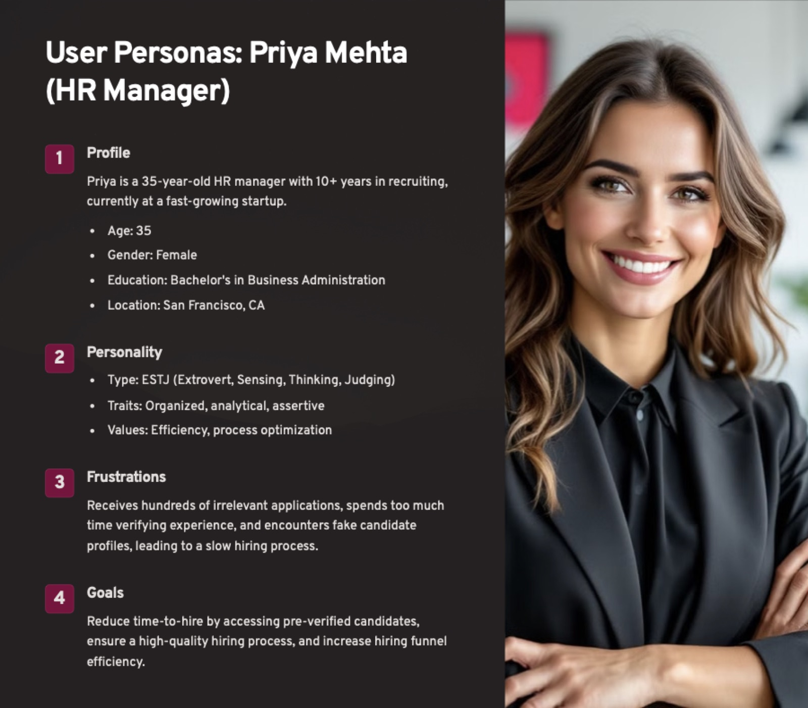
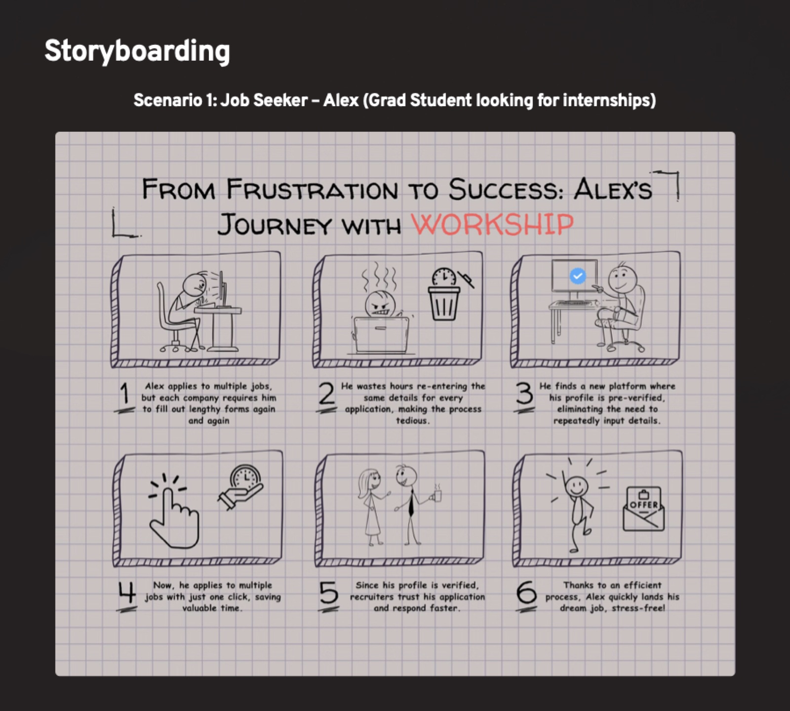
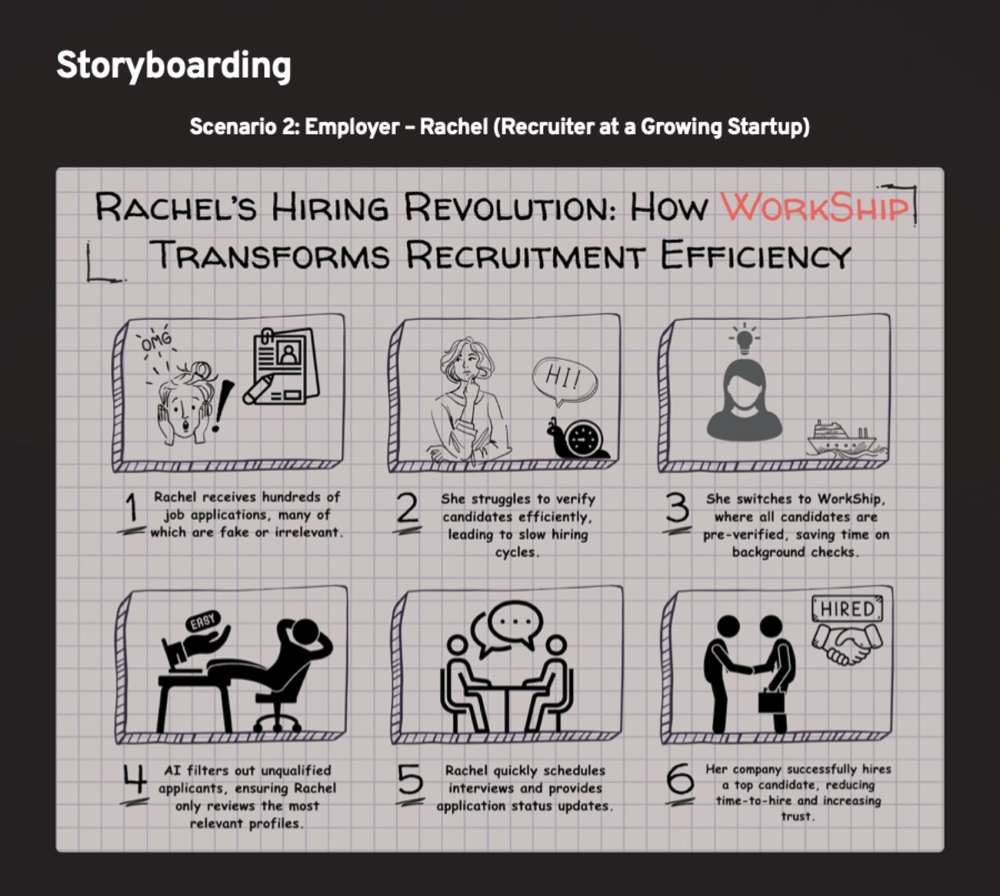

# Research

[← Back to README](../README.md)

## Problem statement

> Recruiters and companies are overwhelmed with fake, inflated or irrelevant applications, making it difficult to identify the right talent. Qualified candidates get lost in a sea of spam applications, face redundant form-filling across platforms and struggle with opaque hiring processes.

## Target audience

**Job seekers**

- Experienced professionals
- Students looking for internships
- Students looking for full-time roles (recent grads)
- Career changers
- Freelancers
- Contract workers

**Employers and recruiters**

- Talent acquisition agencies
- Organizations hiring directly

### Segment snapshots

| Segment | Age | What they do | What they want |
|---|---|---|---|
| Students looking for internships | 18–25 | Apply to many internships at once, look for verified companies to avoid unpaid or fake ones | Experience that fits their career goals |
| Experienced professionals | 25–50 | Look for growth, higher pay and stability | Fewer irrelevant roles, faster cycles |
| Talent acquisition agencies | 28–50 | Want pre-verified candidates and filter by skills | An efficient process with no time lost on fakes |
| Organizations (direct hire) | 30–55 | Struggle with high volumes of unverified applications | Authentic candidates and fair hiring |

## User needs

**Job seekers want to**

- apply without filling in the same forms again and again
- compete fairly, without fake profiles in the pool
- see only real, verified postings, with no scams or dead ends

**Recruiters want to**

- be sure a candidate's experience and education are real
- shorten the hiring cycle and raise the quality of hires

## Pain points

| # | Job seekers | Recruiters |
|---|---|---|
| 1 | **Fake job listings**: scams and fraud on portals | **High volume of fake applications** |
| 2 | **Long, repetitive applications** | **Duplicate applications** with different resumes |
| 3 | **No transparency**: poor communication and no feedback | **Identity and experience verification** is hard |
| 4 | **Finding roles that fit** their profile | **Lengthy background checks** before onboarding |
| 5 | **Delayed offers** caused by background verification | **High recruitment costs** across boards and checks |

## Personas

**Alex Sharma: recent graduate.** 23, BS in Computer Science, San Francisco. Tech-savvy, ambitious, values work-life balance and continuous learning.

- *Frustrations:* fills out long applications for every job, gets rejected for lack of experience while seeing others fake theirs, wastes effort on fake postings.
- *Goals:* find genuine roles without repetitive applications, stand out with verified credentials, get timely status updates.

**Priya Mehta: HR manager.** 35, 10+ years in recruiting at a fast-growing startup, San Francisco. Organized, analytical, focused on process efficiency.

- *Frustrations:* hundreds of irrelevant applications, too much time spent verifying experience, fake candidate profiles slow every hire.
- *Goals:* cut time-to-hire with pre-verified candidates, keep quality high, make the funnel more efficient.

## Empathy maps

### Job seeker

| Says | Thinks |
|---|---|
| "I'm tired of filling out the same job application again and again." · "It's frustrating to compete with candidates who fake their experience." · "I want an easier way to showcase my skills and get noticed." | What if I'm rejected because they don't trust my experience? · I don't want to waste time if they won't even look at my profile. · Will this platform actually help me get a job faster? |
| **Does** | **Feels** |
| Spends hours on company portals · Keeps LinkedIn and resume updated · Networks for referrals to skip long processes · Applies widely but rarely hears back | Frustrated by repetitive applications · Worried about competing with fake candidates · Hopeful a verified profile gives an edge |

### Employer

| Says | Thinks |
|---|---|
| "We need candidates with real skills and experience." · "There are too many duplicate or fake profiles." · "Verifying candidates is time-consuming." · "We need a reliable way to filter out unqualified applicants." | How do we confirm candidates are genuine without spending too much time? · Are we losing good people to long processes? · LinkedIn alone is full of fake profiles. · Are automated filters making us miss great talent? |
| **Does** | **Feels** |
| Manually reviews applications for hours · Relies on Workday and ATS filters · Discards resumes that look suspicious · Filters on keyword matches, which is often ineffective | Overwhelmed by volume · Skeptical of authenticity · Pressured to hire fast without losing quality · Excited by a verified system |

## Storyboards

**Scenario 1: Alex, a grad student looking for internships**

**Scenario 2: Rachel, a recruiter at a growing startup**

## Why these methods

| Method | Why we chose it | What it gave us |
|---|---|---|
| Competitive analysis | Shows where LinkedIn, Indeed and Workday fall short | A sharper value proposition: verified profiles and seamless applications |
| Empathy maps | Captures emotions and motivations, not just actions | Hidden frustrations that interviews and surveys miss |
| Storyboarding | Turns journeys into narratives the whole team can see | Friction points spotted, and the team aligned before designing screens |
