# Screens

[← Back to README](../README.md) · [Open the Figma file](https://www.figma.com/design/CRmPtlj1NyeqXDfQQQRSwM/Workship---Wireframes) · [Run the prototype](https://www.figma.com/proto/CRmPtlj1NyeqXDfQQQRSwM/Workship---Wireframes?node-id=0-1&t=ZczFhPyOQYl5Miyo-1)

The Figma file is organized into labeled sections, one per flow:

| Section in Figma | What it covers |
|---|---|
| `LANDING AND LOGIN SCREENS` | Marketing landing, sign-up and sign-in, with a job hunter / recruiter toggle |
| `PROFILE CREATION AND ONBOARDING` | Building the one-time verified profile, plus a guided product tour |
| `JOB HUNTER HOME PAGE VARIATIONS` | Home dashboard: search, matched skills, featured jobs, company notifications |
| `JH PROFILE SCREEN VARIATIONS` | Job hunter profile and verification badges |
| `CANDIDATE RE-VERIFICATION FLOW` | Re-verifying expired or changed credentials |
| `MORE SECTION (CAREER COMPASS …)` | Career Compass journey dashboard, Wingman AI, help |
| `Analytics` | Application and journey analytics |
| `RECRUITER END-TO-END FLOW` | Post a job → review verified applicants → move candidates through stages → hire |
| `Components/ Cards/ Images` | Shared cards, buttons and imagery |

## 1. Sign-up

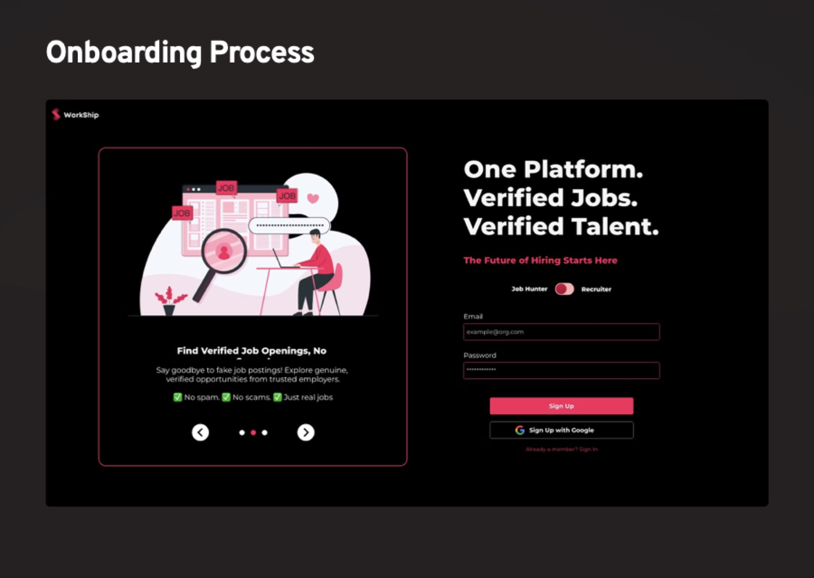

A split layout: a carousel of value props on the left ("Find verified job openings: no spam, no scams, just real jobs") and the form on the right. One **Job Hunter / Recruiter** toggle routes both audiences through the same entry point. Google sign-up is offered as a lower-effort path.

## 2. Guided onboarding

A four-step coach-mark tour over the home dashboard. The background is blurred so each step has a single focus.

| Welcome | 1 · Browse jobs |
|---|---|
| 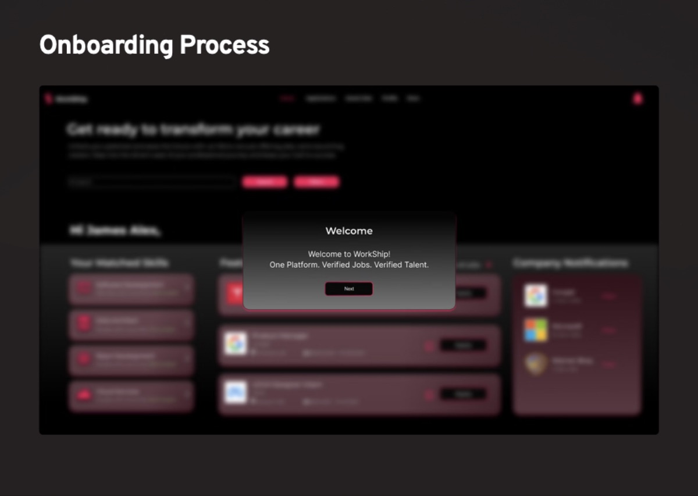 | 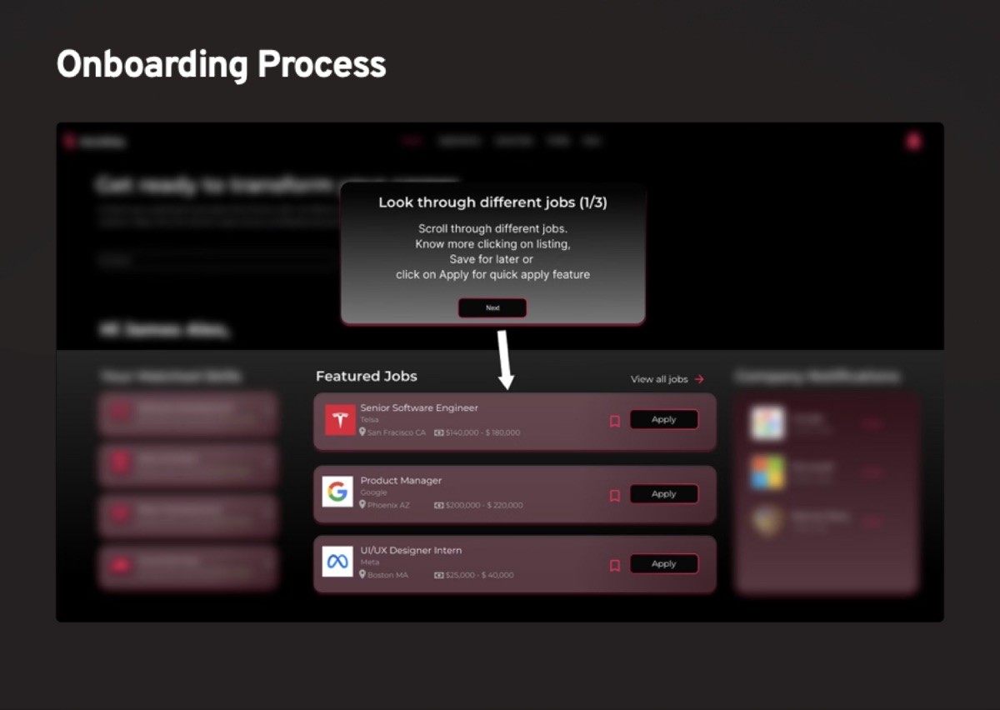 |
| **2 · Navigate** | **3 · Stay updated** |
| 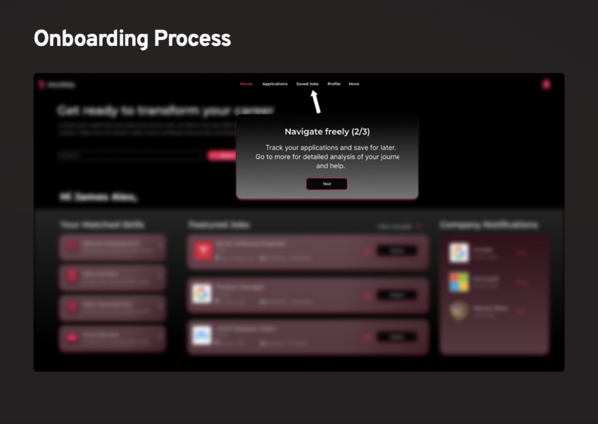 | 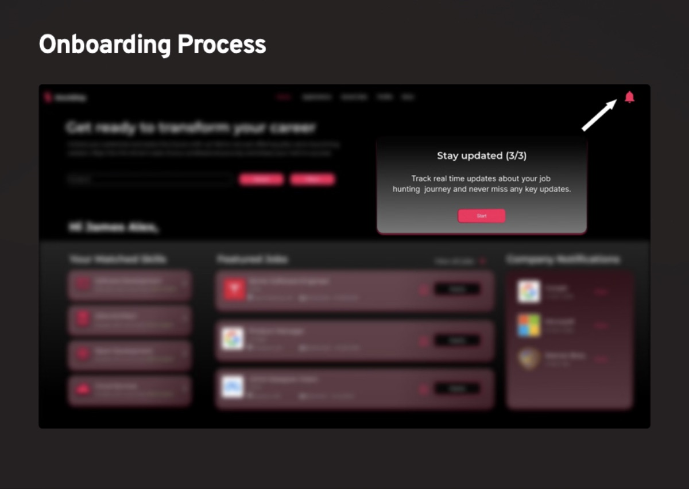 |

## 3. Job hunter home

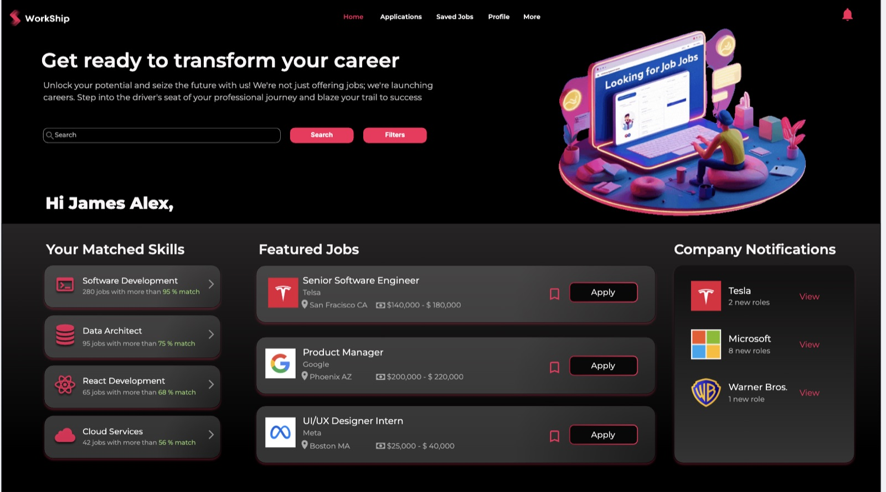

- **Top nav:** Home · Applications · Saved Jobs · Profile · More, with notifications on the right
- **Search + Filters** above the fold
- **Your Matched Skills:** each skill shows how many open roles match it and the match %
- **Featured Jobs:** verified listings with salary, location, Save and one-click **Apply**
- **Company Notifications:** followed companies with new roles

## 4. Design v2 gallery

In the Figma file, every v2 frame is named `v2 / <name>` and sits 26,000px to the right of its v1 original. Changes are described in [design-review.md](design-review.md) and [CHANGELOG](../CHANGELOG.md).

| Sign-up | Home |
|---|---|
| 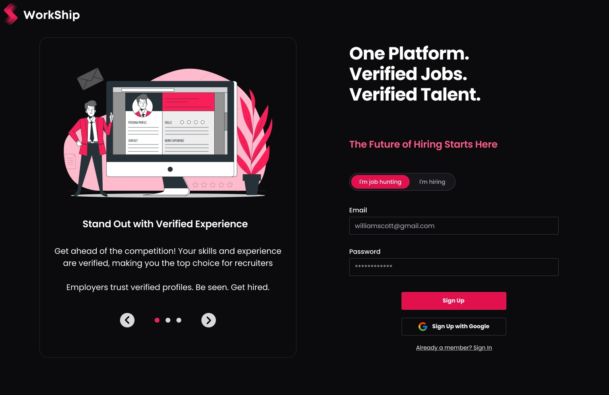 | 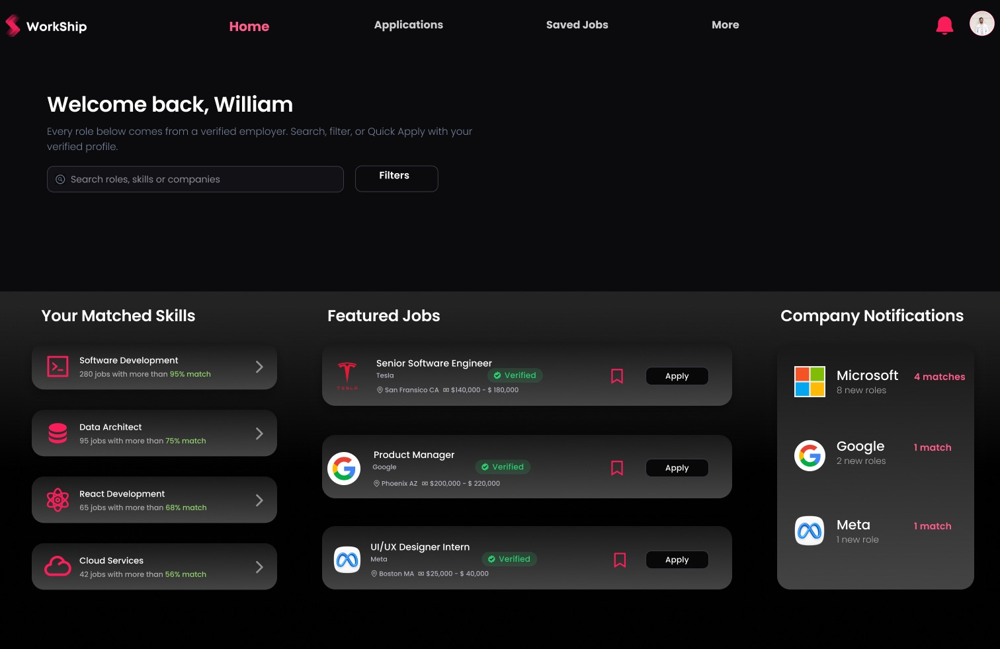 |
| **Applications** | **Saved jobs** |
| 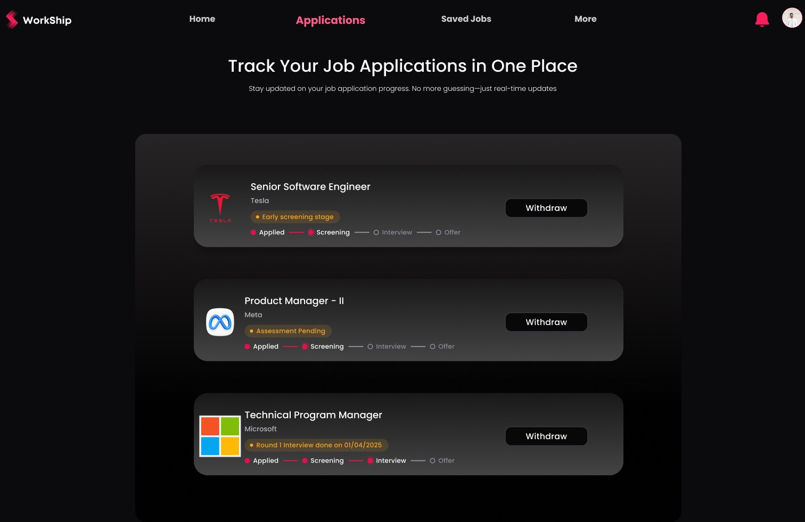 | 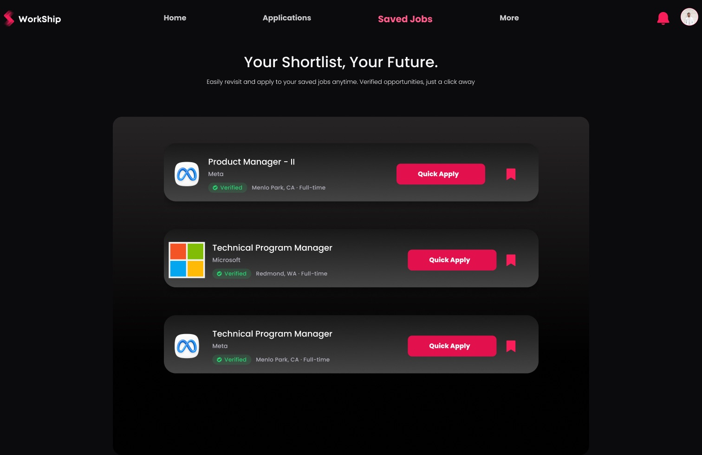 |
| **Credential verification** | **Career Compass** |
| 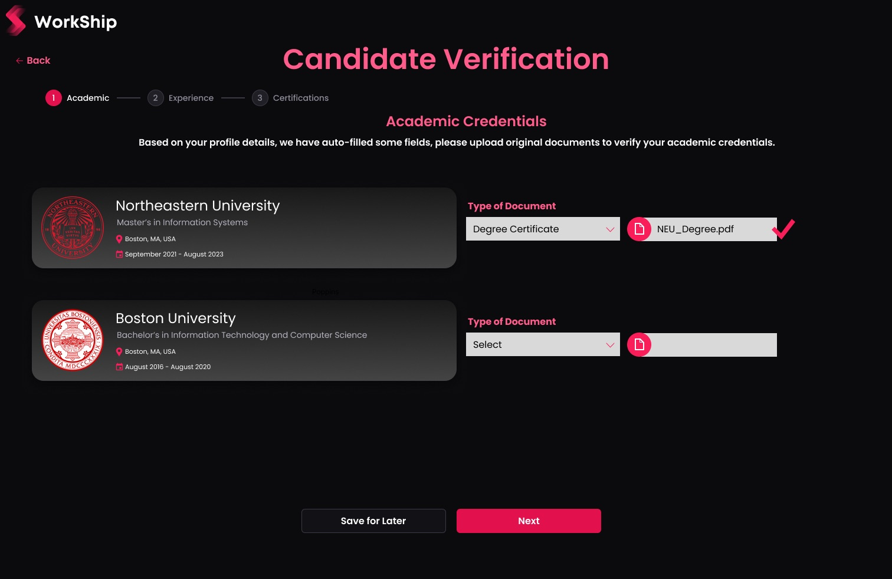 | 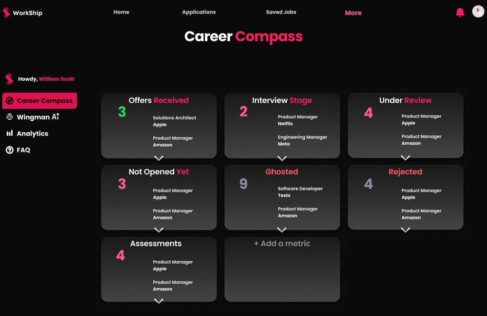 |
| **Wingman AI** | **Analytics** |
| 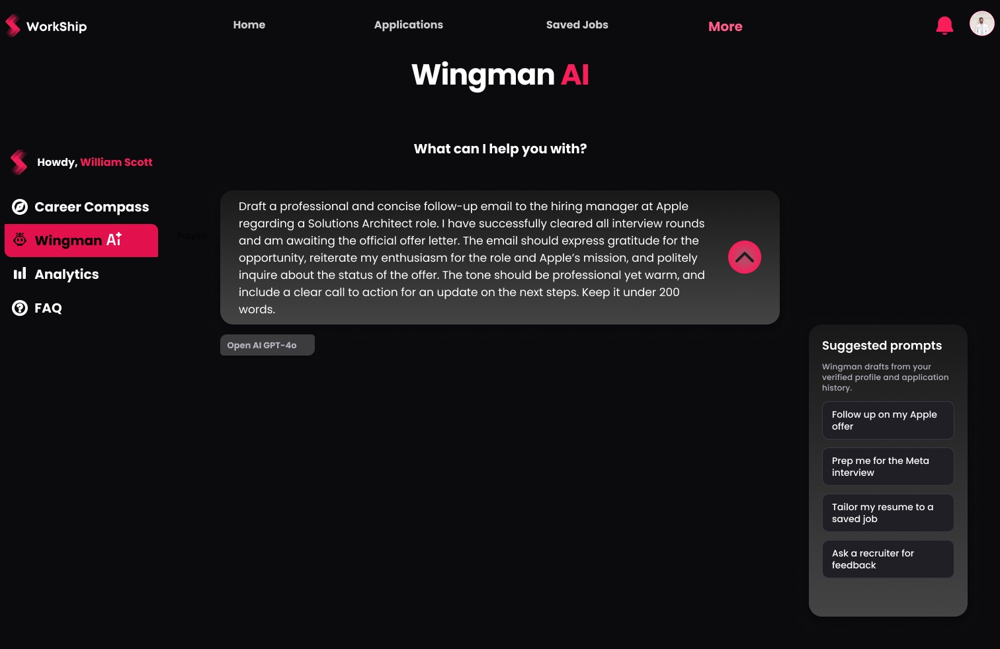 | 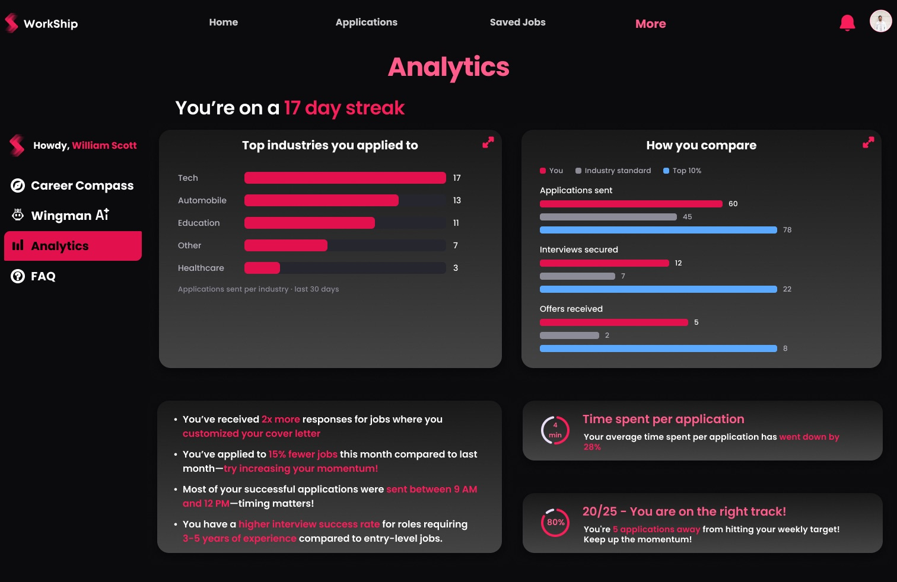 |
| **Recruiter home** | |
| 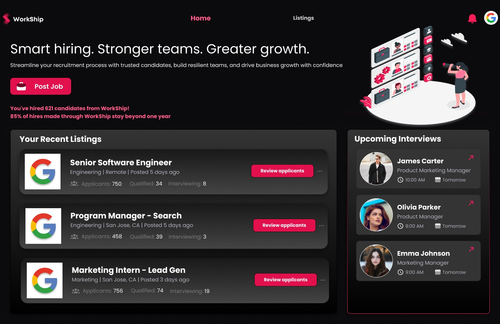 | |
